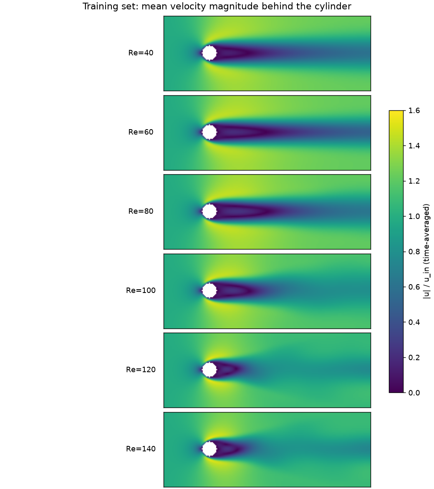
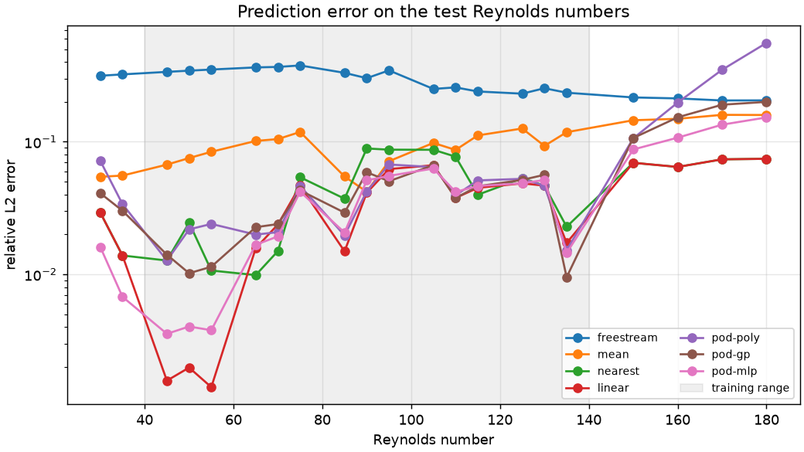

# CFD Flow Prediction Benchmarking Suite

Master's thesis project (Master in High Performance Computing, Universidade da Coruña, 2024-2025; supervisors: Emilio J. Padrón González and Omar A. Mures).

**Problem.** In CFD flow prediction, models are rarely tested on common datasets and code is often not shared, so results are hard to reproduce and compare. This repository is a small, reproducible benchmarking suite that covers the full loop:

| Goal of the thesis | What this repository provides |
|---|---|
| Validated reference datasets | A cylinder-flow dataset generated by a built-in lattice Boltzmann solver, with fixed train / interpolation / extrapolation splits, a version and a checksum |
| Standard preprocessing and post-processing | `cfdbench.preprocessing` (normalization on fluid cells, masking, resampling, image export) and `cfdbench.metrics` (MSE, MAE, relative L2, wake error, divergence) |
| Online platform with a leaderboard | A FastAPI web app: dataset download, submission upload, server-side scoring and a ranked leaderboard (SQLite) |
| Reproducibility | Pinned dataset version and checksum, fixed seeds, tests, CI, Dockerfile |

> **Scope note.** The reference data are *simulated* (2D laminar flow, Re 30-180), not experimental measurements. See [Limitations](#limitations).

## The benchmark task

Given the Reynolds number, predict the **time-averaged velocity field** `(u, v)` of the 2D flow past a circular cylinder on a 200 x 72 grid (values are divided by the inlet velocity).

| Split | Reynolds numbers | Purpose |
|---|---|---|
| `train` | 40, 60, 80, 100, 120, 140 | fit the model |
| `test_interp` | 45, 50, 55, 65, 70, 75, 85, 90, 95, 105, 110, 115, 125, 130, 135 (15 cases) | generalization between training points |
| `test_extrap` | 30, 35, 150, 160, 170, 180 (6 cases) | generalization outside the training range |

The wake changes with Re (the recirculation bubble shrinks, and in an unbounded domain vortex shedding starts around Re 47), so the task is not trivial.



## Baseline results

Relative L2 error (lower is better), mean over the test cases of each split. Produced by `cfdbench benchmark`; full metrics are in [`results/benchmark.json`](results/benchmark.json).

| Model | Idea | `test_interp` | `test_extrap` |
|---|---|---|---|
| `linear` | pixel-wise linear interpolation in Re | **0.031** | 0.054 |
| `pod-mlp` | POD (5 modes) + small neural network (MLP) on the coefficients | 0.032 | 0.084 |
| `pod-gp` | POD (5 modes) + Gaussian-process regression | 0.035 | 0.120 |
| `pod-poly` | POD (5 modes) + cubic regression of the coefficients | 0.036 | 0.219 |
| `nearest` | field of the closest training Re | 0.044 | 0.054 |
| `mean` | average training field | 0.090 | 0.121 |
| `freestream` | uniform flow, no obstacle | 0.306 | 0.246 |

What it shows:

- Interpolation is easy for simple methods on this smooth family of flows; `linear` wins.
- Polynomial regression on POD coefficients is accurate inside the training range and **diverges outside it** (0.219 at extrapolation, worse than the average field). The neural network and the Gaussian process degrade less, and clamped methods (`linear`, `nearest`) degrade gracefully.
- No baseline truly extrapolates: this is the open part of the benchmark and the reason for a separate split.



## Solver validation

The shedding frequency (Strouhal number `St = f D / U`) measured from a probe in the wake (`cfdbench.validation`, results in [`results/validation.json`](results/validation.json)) is compared with Williamson's fit for an unconfined cylinder, `St = 0.2665 - 1.018 / sqrt(Re)`:

| Re | Domain | Blockage `D / ny` | St measured | St reference | Relative error |
|---|---|---|---|---|---|
| 100 | dataset (200 x 72) | 19.4 % | 0.191 | 0.165 | +16 % |
| 100 | twice as wide (200 x 144) | 9.7 % | 0.178 | 0.165 | +8 % |
| 140 | dataset (200 x 72) | 19.4 % | 0.203 | 0.180 | +12 % |
| 140 | twice as wide (200 x 144) | 9.7 % | 0.191 | 0.180 | +6 % |

The solver produces the right behavior (shedding starts, St increases with Re) but **overestimates St**, and the error roughly halves when the blockage is halved, so confinement (periodic top and bottom boundaries) explains a large part of it. The rest probably comes from the coarse resolution (14 cells per diameter), which I did not test. The dataset therefore represents a *confined* cylinder flow, which is fine for a benchmark of prediction models but not for physical conclusions. Drag was not validated.

## Quick start

```bash
git clone https://github.com/Gotrone/TFM.git
cd TFM
python -m venv .venv
.venv\Scripts\activate          # Linux / macOS: source .venv/bin/activate
pip install -e ".[dev]"

cfdbench benchmark --reset      # run all baselines, fill the leaderboard, write figures
cfdbench serve                  # web platform on http://127.0.0.1:8000
pytest                          # 23 tests
```

The dataset (`data/cylinder_flow.npz`, 2.8 MB) is committed. To regenerate it from scratch (27 simulations; it took about half an hour on my 16-thread laptop, because parallel runs compete for memory bandwidth): `cfdbench generate`.

With Docker (image built and run on Windows with Docker Desktop):

```bash
docker build -t cfdbench .
docker run -p 8000:8000 cfdbench
```

### Command-line interface

| Command | Description |
|---|---|
| `cfdbench generate` | run the LBM simulations and write the dataset |
| `cfdbench info` | print the dataset description (grid, splits, checksum) |
| `cfdbench benchmark` | fit the baselines, score them, store results, draw figures |
| `cfdbench leaderboard` | print the leaderboard |
| `cfdbench evaluate submission.npz` | score a submission locally |
| `cfdbench serve` | start the web platform |

## Benchmark your own model

In Python, register a model (fit on the training split, predict from a Reynolds number):

```python
import numpy as np
from cfdbench import models

@models.register("my-model")
class MyModel(models.Model):
    def fit(self, reynolds, fields, mask):   # fields: (N, 2, nx, ny)
        ...
        return self
    def predict(self, reynolds):             # -> (len(reynolds), 2, nx, ny)
        ...
```

Or work outside the library and upload the result to the web platform:

1. Download the training split from the web page (`/api/dataset/train`). It contains the training fields and only the *Reynolds numbers* of the test splits, never the test fields.
2. Predict the test splits and save them:

   ```python
   np.savez("submission.npz", test_interp=pred_interp, test_extrap=pred_extrap)
   # each array: shape (N, 2, nx, ny), samples in ascending Reynolds order
   ```
3. Upload it on the page (or `POST /api/submit` with `model`, `author` and `file`). The server scores it and adds it to the leaderboard.

## Architecture

```
src/cfdbench/
├── lbm.py             # D2Q9 regularized lattice Boltzmann solver (cylinder in a channel)
├── dataset.py         # splits, parallel generation, .npz storage, loading, checksum
├── preprocessing.py   # Standardizer (fluid cells only), downsample, crop, field_to_image
├── metrics.py         # evaluation metrics on fluid cells
├── models.py          # Model interface, registry and the 7 baselines
├── benchmark.py       # fit / predict / score loop, submission scoring
├── leaderboard.py     # SQLite storage and ranking
├── figures.py         # figures for the report
├── cli.py             # `cfdbench` command
└── web/               # FastAPI app and static front end
tests/                 # 23 tests (solver, preprocessing, metrics, models, API)
data/cylinder_flow.npz # the versioned dataset
results/               # benchmark.json and figures
```

**Metrics** (computed on fluid cells only, averaged over the samples of a split):

| Metric | Meaning |
|---|---|
| `rel_l2` | ‖prediction − truth‖ / ‖truth‖, the **ranking metric** |
| `mse`, `mae` | mean squared / absolute error on `u` and `v` |
| `max_abs` | largest cell error |
| `wake_rel_l2` | `rel_l2` restricted to the region downstream of the cylinder |
| `div_rms` | RMS divergence of the prediction (physical consistency: the mean flow of an incompressible fluid is divergence-free) |

**Solver.** Regularized BGK lattice Boltzmann, uniform inlet velocity, zero-gradient outlet, periodic top and bottom, bounce-back on the cylinder (diameter 14 cells, 200 x 72 grid, inlet velocity 0.08 in lattice units). Each case runs 10,000 warm-up steps, then averages 3,200 steps (a few shedding periods).

## Limitations

- **Simulated data, not experimental.** The goal of the thesis was *experimentally validated* datasets (for example the FDA nozzle and blood pump benchmarks, FlowBench, CFDBench). This repository only prepares the pipeline and uses a self-generated dataset so that everything runs offline in minutes. Conclusions about real flows cannot be drawn from it.
- **The solver is only partly validated**: St is 6 to 16 % above the literature (see above), drag is not checked, and grid convergence was not tested. The blockage of 19 % with periodic top and bottom boundaries biases the flow compared with an unbounded cylinder. The dataset keeps this geometry so that results stay comparable.
- **One narrow task**: 2D laminar flow, one geometry, one parameter (Re), mean field only. No unsteady prediction, no pressure, no turbulence, no 3D, no other obstacle shapes.
- **Modest test sets**: 15 interpolation and 6 extrapolation cases, all from one smooth family of flows. Differences of a few percent between models should not be over-interpreted.
- **Baselines are small**: interpolation, POD regression and a small MLP on POD coefficients. There is no CNN, U-Net or neural operator, which are the models the benchmark is ultimately meant for (they need a deep-learning framework and more data than 6 training fields).
- **Web platform is a prototype**: submissions are limited to 25 MB, names are validated, an optional API key (`CFDBENCH_API_KEY`) protects the upload and a per-IP limit (`CFDBENCH_RATE_LIMIT`, default 10 per hour) slows spam. The limit is kept in memory (lost at restart, not shared between processes), there are no user accounts, and anyone can still submit predictions tuned on the public test Reynolds numbers. SQLite and a single process do not scale. The test ground truth is stored in the dataset file used by the server.
- **Not an exhaustive literature review**: only the benchmarks cited above were considered.

## Possible improvements

1. Add experimentally validated data (PIV or the FDA benchmarks) and real CFD datasets (CFDBench, FlowBench) through the same `CFDDataset` interface; regenerate the dataset in a wider domain at higher resolution and validate drag too.
2. Add deep-learning baselines (CNN / U-Net, Fourier neural operator) and a GPU training script for the HPC cluster.
3. Widen the task: several geometries and parameters, unsteady prediction (rollout error), pressure and vorticity.
4. Add metrics that matter physically (vorticity, recirculation length, drag) and statistical significance (more test cases, confidence intervals).
5. Harden the platform: authentication, rate limiting, a job queue for evaluation, a database such as PostgreSQL, HTTPS (for example behind a reverse proxy).
6. Add dataset versioning with DVC or a registry, and a scheduled CI job that re-runs the baselines.

## License

No license has been chosen yet: all rights reserved until one is added.
